# Portable COTS mmWave Radar for Small-Drone Detection

**UREx Project Report: Extending Detection Range and Improving Operation**

Ang Ding Li Victor  A0307828W  Supervised by Assoc Prof Koenraad Mouthaan  National University of Singapore  November 2026

## Abstract

This project built a portable radar from commercial off-the-shelf (COTS) parts to detect, track and classify small drones, and then tried to make it see further and easier to operate. The system uses a Texas Instruments IWR6843ISK-ODS 60 to 64 GHz radar, a DCA1000EVM raw-data capture board and an NVIDIA Jetson Orin Nano, mounted in a 3D-printed chassis on a camera tripod and powered by a swappable power bank. In the first stage, the team produced two working processing methods, a conventional range-Doppler method (Mode 1) and a rotor-sensitive periodic-micro-motion method (Mode 2), with trained classifiers. A hovering DJI Mini 4 Pro was detectable to about 3.2 to 4.0 m. In the second stage, which is the focus of this report, I developed a graphical operator interface with a top-down target display and two extended-range modes. Mode 3 uses a longer-range radar profile with beam-space track-before-detect processing. Mode 4 keeps the Mode 1 profile and makes its detection step more sensitive. In field tests with a DJI Lito X4, Mode 4 detected both the drone and a person out to 11 to 12 m. Mode 3 detected a person to about 11 m and the drone to about 9 m. Classification remained unreliable beyond about 7 m because the classifiers were trained only on first-stage data.

**Keywords:** FMCW radar; mmWave; COTS; IWR6843ISK-ODS; DCA1000EVM; Jetson Orin Nano; UAV detection; track-before-detect; operator interface.

## Acknowledgements

[INSERT: your acknowledgements in your own words. Your earlier wording is still in UREx_Report_Draft_Hardware_Focus.md if you want to reuse it. Suggested points: Assoc Prof Koenraad Mouthaan; groupmates You Qixuan (A0308105R) and Weng Xian Yang (A0307751E); laboratory staff.]

## Contents

[[TOC]]

[[PAGEBREAK]]

## 1. Introduction

### 1.1 Motivation

Small unmanned aerial vehicles (UAVs) are now common in civilian, commercial and military use, which creates a need for affordable ways to detect and monitor them. They are difficult radar targets. They are compact, much of their structure is plastic, they can hover, and their reflection is weak and changes as they turn. A portable radar adds limits on power, computing and setup time, and still has to cope with clutter from the surroundings.

This project set out to show that a working drone-detecting radar can be built from off-the-shelf parts, and then to find how much range such a setup can achieve.

### 1.2 Project stages and objectives

The project ran in two stages.

**Stage 1 (team).** Procure and assemble the hardware, develop two processing methods, calibrate the radar, collect training data and train classifiers that separate UAVs from non-UAV targets.

**Stage 2 (my own work).** My groupmates had completed their parts and left for exchange, so I continued alone with three objectives:

1. Develop a graphical interface so that the radar can be configured, started and monitored without typing commands.
2. Extend the detection and tracking range on the same hardware.
3. Test the extended-range modes in the field and compare them with the first-stage results.

### 1.3 Scope and contributions

This report summarises Stage 1 only as far as needed to understand Stage 2. The first-stage details are in my groupmates' reports [1], [2], and results taken from them are cited. Table 1 shows who did what.

**Table 1.** Contribution boundaries.

| Work | Who | Where it is reported |
|---|---|---|
| Component selection, procurement and hardware integration | Me | This report, Section 3 |
| 3D-printed chassis design (SolidWorks) | Me | This report, Appendix A |
| Radar profile design, calibration, aluminium-tape experiment, controlled evaluation | Qi Xuan | [1]; summarised in Section 2 |
| Dataset collection | Qi Xuan and me | [1]; summarised in Section 2 |
| Start-up and capture software, Mode 1 and Mode 2 processing, classifier training, live inference | Xian Yang | [2]; summarised in Section 2 |
| Operator interface and top-down target display | Me | Sections 4 and 5 |
| Mode 3 and Mode 4 development and field testing | Me | Sections 4, 6 and 7 |

[INSERT: adjust any row that does not match how the team actually split the work.]

## 2. Stage 1 summary: the shared starting point

### 2.1 Why this hardware

The team first considered longer-range X-band sensing. Singapore's short-range-device rules limit operation in the 57 to 64 GHz band to 100 mW EIRP [6], and compact X-band hardware with both transmit and receive was hard to source within the budget and schedule. The IWR6843ISK-ODS was chosen because it is readily available and can stream raw data through the DCA1000EVM. The priority was a complete working chain before any range optimisation [1].

### 2.2 The two first-stage methods

**Mode 1, conventional.** Each frame is turned into a range-Doppler map. An ordered-statistic CFAR detector picks out cells that stand above the local background, the detections are converted to 3D points, grouped with DBSCAN and followed by a single-target tracker. A small convolutional neural network (CNN) classifies the target from 48 frames (1.6 s) of micro-Doppler history [2].

**Mode 2, rotor-sensitive (PMM).** This follows the spectrum-folding idea of He et al. [3]. The Doppler spectrum is folded over candidate periods so that the regularly spaced returns from spinning rotors add up. A background learned from 300 target-free frames is subtracted, a continuity-constrained path is followed through range and time, and a particle filter smooths the result. A long short-term memory (LSTM) network classifies the target from 36 frames (3.6 s) of Doppler-time history [2].

### 2.3 Radar profiles

The two methods use different radar settings, shown in Table 2 with the long-range profile I added in Stage 2. Mode 4 reuses the Mode 1 profile unchanged.

**Table 2.** Radar profiles. Mode 1 and Mode 2 values are from [1]; Mode 3 values are calculated from the profile file in the repository [7].

| Parameter | Mode 1 and Mode 4 | Mode 2 | Mode 3 |
|---|---|---|---|
| Start frequency | 60.00 GHz | 60.25 GHz | 60.25 GHz |
| Frequency slope | 60.000 MHz/µs | 46.875 MHz/µs | 9.994 MHz/µs |
| ADC samples per chirp | 64 | 256 | 256 |
| ADC sample rate | 5.00 MS/s | 6.25 MS/s | 6.25 MS/s |
| Transmit / receive | 3 TX (TDM) / 4 RX | 3 TX (TDM) / 4 RX | 3 TX (TDM) / 4 RX |
| Loops / chirps per frame | 128 / 384 | 32 / 96 | 32 / 96 |
| Frame period | 33.33 ms | 100 ms | 100 ms |
| Sampled bandwidth | 0.768 GHz | 1.920 GHz | 0.409 GHz |
| Range bin | about 0.195 m | about 0.078 m | about 0.366 m |
| Maximum unambiguous range | about 12.5 m | about 20.0 m | about 93.8 m |
| Maximum unambiguous radial velocity | about 10.7 m/s | about 0.46 m/s | about 0.46 m/s |

The maximum unambiguous range is only the furthest distance the profile can represent. It is not a detection range. In Stage 1 the drone's reflection became too weak long before either limit was reached [1].

### 2.4 Calibration

Qi Xuan calibrated range with an E23012 corner reflector placed 2 to 3 m away on a second tripod, using a laser range finder as the reference. The radar read long by a repeatable amount, which is now applied as a correction (Table 3). Angle trials gave offsets of only 2 to 4 degrees that were not repeatable, so no angle correction is applied [1].

**Table 3.** Range bias from corner-reflector calibration [1].

| Profile | Measured range bias |
|---|---|
| Mode 1 (conventional) | +11.9 cm |
| Mode 2 (PMM) | +10.0 cm |

### 2.5 First-stage results

**Static range.** The DJI Mini 4 Pro was flown outward along boresight and hovered at intervals until it disappeared from the display. One layer of aluminium foil tape on the body was tried as a temporary way to strengthen the reflection (Table 4).

**Table 4.** Stage 1 static (hover) detection boundary, mean ± sample standard deviation [1].

| Method | Without tape | With tape | Increase |
|---|---|---|---|
| Mode 1 (conventional) | 3.16 ± 0.05 m (n = 5) | 3.66 ± 0.05 m (n = 5) | +0.50 m (+15.8%) |
| Mode 2 (PMM) | 3.64 ± 0.35 m (n = 8) | 3.96 ± 0.11 m (n = 5) | +0.32 m (+8.9%) |

The tape result shows that received target strength was the main limit. Received power falls with the fourth power of range, so even a clearly stronger reflection buys only a modest range increase. Moving drones were consistently seen further away than hovering ones, but no number was reported because there was no independent position reference [1]. In my own first-stage runs, Mode 1 held a moving Mini 4 Pro to about 6.5 m, and about 7 m with tape. [INSERT: confirm these two figures and how they were measured, or remove this sentence.]

**Tracking and classification.** In controlled six-minute runs over marked floor paths, both methods kept a track for most of the run and gave the correct overall label (Table 5).

**Table 5.** Stage 1 controlled-test tracking and classification [1], [2].

| Method | Target | Tracking continuity | Track-loss events | Accuracy when classified | Share of frames with a decision |
|---|---|---|---|---|---|
| Mode 1 | UAV | 95.50% | 3 | 96.60% | 93.8% |
| Mode 1 | Pedestrian | 96.91% | 1 | 100.00% | 96.0% |
| Mode 2 | UAV | 94.75% | 7 | 96.51% | 82.1% |
| Mode 2 | Pedestrian | 99.13% | 0 | 98.11% | 91.3% |

**Running on the Jetson.** Both methods processed every frame with no packet loss (Table 6).

**Table 6.** Stage 1 runtime on the Jetson Orin Nano [2].

| Method | Frame rate | Processing time, median / 95th percentile | Frames over the frame period | Mean CPU / GPU use |
|---|---|---|---|---|
| Mode 1 | 29.6 to 29.7 fps | 20.0 / 31.8 ms | 2.97% of 22,070 | 49 to 51% / 35 to 36% |
| Mode 2 | 9.8 to 9.9 fps | 76.5 / 84.0 ms | 1.38% of 7,756 | 37 to 38% / 8 to 10% |

### 2.6 What Stage 1 left open

Three points from my groupmates' reports set the direction for Stage 2:

- The usable range was only a few metres, and both reports identified weak received signal as the cause [1].
- Qi Xuan recommended looking for processing gain by combining repeated observations [1].
- The system was operated by typing commands over a remote desktop, and the displays were built for debugging more than for an operator [2].

## 3. System overview

### 3.1 Hardware

The prototype has three main boards (Table 7). All of them sit in the chassis described in Appendix A.

**Table 7.** Main components.

| Component | Role |
|---|---|
| TI IWR6843ISK-ODS | 60 to 64 GHz FMCW radar front end with 3 transmit and 4 receive antennas |
| TI DCA1000EVM | Captures the radar's raw ADC samples and sends them to the Jetson over Ethernet |
| NVIDIA Jetson Orin Nano 8GB | Runs capture, signal processing, tracking, classification, logging and the display |
| USB-PD power bank | Powers the DCA1000EVM (5 V) and the Jetson (20 V) through USB-PD to barrel cables |
| 3D-printed chassis and camera tripod | Holds the boards and power bank at a fixed height and pointing direction |

**Why the DCA1000EVM is needed.** The radar board can only send a processed point cloud over its USB serial link, at roughly 100 kB/s. The raw samples come out on a high-speed LVDS link that the Jetson has no way to receive. The DCA1000EVM receives that LVDS stream on its 60-pin connector, packs it into UDP packets and sends it over gigabit Ethernet [4]. Without it, the Jetson could not run any of the custom processing in this project.

The radar board takes its power from the DCA1000EVM through the same 60-pin connector. A Micro-USB cable from the radar to the Jetson carries the control commands [1].

[INSERT FIGURE: a labelled photograph of the assembled prototype on its tripod.]

### 3.2 Start-up and data path

Start-up follows a guarded order written by Xian Yang [2]. The Jetson first opens its data receiver. It then configures the radar over the serial link, configures and arms the DCA1000EVM, and only then tells the radar to start. Every packet carries a sequence number, so gaps are detected and damaged frames are rejected before processing. Stage 2 reuses this path unchanged.

The Jetson has no monitor attached, so it is operated from a laptop over remote desktop. Stage 1 used RealVNC [2]. I currently use RustDesk.

## 4. Stage 2 development

### 4.1 Operator interface

In Stage 1, running the radar meant typing a command with the right mode, serial port, network settings and display option. A wrong option or a leftover process from the previous run would stop it from starting. I wrote a touchscreen-friendly interface that puts these steps on screen (Table 8).

**Table 8.** Interface tabs.

| Tab | What the operator does there |
|---|---|
| Run | Choose one of the four modes and its display, switch Mode 4's detection steps on or off, label a run as drone or not-drone for later scoring, start and stop |
| Hardware and files | Pick the radar's serial port and the Ethernet interface, set the Jetson's address for the DCA1000EVM with one button, choose where recordings are saved |
| Tracking | Adjust tracking settings for the selected mode |
| Activity | Read the live log from the capture and processing programs |

Two additions came directly from problems met in testing:

- **Stop all radar processes.** A run that failed could leave a process holding the data port, and the next run would report "receiver not ready". An orange button now stops every leftover process and checks that the ports are free. The interface also offers this clean-up automatically when a start fails for that reason.
- **Run labels in the log.** Each run's log records the mode and the enabled options, so a recording can be identified afterwards without guessing from its contents.

[INSERT: one or two sentences in your own words on what you found most useful or most difficult about building the interface.]

[INSERT FIGURE: a screenshot of the interface's Run tab.]

### 4.2 Top-down target display

Stage 1 displays showed range-Doppler maps, 3D point clouds and Doppler-time plots (Figures 8 and 9). These are useful for checking the signal but do not show at a glance where the target is. I added a top-down display in the style of a plan-position indicator (PPI). The radar sits at the bottom centre, range rings and bearing lines mark the search sector, and the tracked target appears as a marker with its recent path behind it.

The display is centred on the radar and is not a surveyed map. The altitude it shows is worked out from range and elevation angle and is not measured separately. Section 5 walks through the display in use.

### 4.3 Mode 3: long-range profile with beam-space track-before-detect

Mode 3 changes both the radar profile and the processing.

**Profile.** The chirp slope is lowered from 46.875 to 9.994 MHz/µs (Table 2). This does not add signal energy. It lowers the frequency at which distant targets appear, so that targets beyond 20 m stay inside the receiver's bandwidth. The cost is a range bin of about 37 cm, compared with about 20 cm for Mode 1 and 8 cm for Mode 2.

**Processing.** The three transmitters fire in turn and the four receivers listen each time, giving 12 virtual channels. Mode 3 combines these 12 channels with the right phase shifts to form beams across ±60 degrees, so that it listens harder in each direction. It then builds up evidence along physically possible paths in beam, range and Doppler over eight frames, and declares a target only when the accumulated evidence is strong enough. A final step refines the angle in 2-degree steps. The classifier is the Mode 2 LSTM, fed with the Doppler history of the selected beam.

Mode 3 went through three versions (Table 9).

**Table 9.** Mode 3 versions.

| Version | What it did | What testing showed |
|---|---|---|
| First (early November) | Mode 2's PMM processing on the long-range profile, with one fixed receive beam | Useful returns at 4 to 6 m but few beyond 6 m. The track snapped to fixed points at about 2 m and 5 m, and the drone was hard to hold past 5 m, which was worse than Mode 1 |
| Rebuilt (13 November) | Beam-space track-before-detect as described above | Tracked a walking person to about 12.5 m (Section 7.2) but locked onto a stationary reflection at about 6 m in an empty scene (Section 7.4) |
| Corrected (13 November) | Rebuilt version with the false-lock correction of Section 7.4 | [INSERT: result of any re-test after the correction, or state that it has not been re-tested] |

### 4.4 Mode 4: Mode 1 with a more sensitive detector

The first Mode 3 tests suggested that the long-range profile was costing more than it gained at the distances I could actually reach. I therefore built Mode 4 on Mode 1 instead. It keeps Mode 1's radar profile, calibration, clustering, tracker and CNN. Only the step that decides which range-Doppler cells count as detections is changed, so any range difference between Mode 1 and Mode 4 comes from that step alone.

Reading the Mode 1 detector and running it on simulated noise showed four places where range was being lost. Mode 4 adds one step for each (Table 10). Each step can be switched on or off from the interface.

**Table 10.** Mode 4 detection steps.

| Step | Problem in Mode 1 | What Mode 4 does |
|---|---|---|
| Calibrated threshold | The detection threshold was far stricter than intended. In 8 million simulated noise cells it produced no false alarms at all | Lowers the threshold to a measured false-alarm rate of one in a million cells, about one stray cell every 5 s, which the tracker rejects |
| Averaged background | The stationary-background estimate was dominated by the first frame, so it was noisy | Uses the equal average of the 30 warm-up frames |
| Coherent beam detection | Power was averaged across the 12 channels without phase, so the antenna array's directional gain was not used for detection | Corrects for target motion between transmitters, forms 37 receive beams across ±60 degrees and uses the strongest beam |
| Multi-frame integration | Every frame was judged alone, so a target just below threshold in every frame was never declared | Adds up evidence along paths of at most 2 range bins and 2 Doppler bins per frame over 8 frames (about 0.27 s) |

Table 11 gives the simulated benefit of each step. The simulation contains only receiver noise, with no clutter or multipath, so these numbers are an upper bound.

**Table 11.** Simulated Mode 4 gain relative to Mode 1 (noise only) [7].

| Configuration | Reduction in target power needed for 50% detection | Equivalent range factor |
|---|---|---|
| Mode 1 | 0 dB | 1.00 |
| Calibrated threshold | 8.3 dB | 1.5 to 1.6 |
| + averaged background | 9.2 dB | 1.7 |
| + coherent beams | 11.6 dB | 1.8 to 1.9 |
| + multi-frame integration | about 15 dB | 2.2 to 2.4 |

Mode 4 inherits one hard limit from the Mode 1 profile: anything beyond about 12.5 m cannot be represented (Table 2).

### 4.5 Approaches tried and set aside

Two other experimental modes were built before the final Mode 4 and were removed from the interface on 12 November. Their code remains in the repository and can be run from the command line.

**Table 12.** Experimental modes not carried forward.

| Mode | Idea | Why it was set aside |
|---|---|---|
| Two-transmitter phased look | Fire two transmitters together with a programmed phase difference to steer the transmit beam within ±30 degrees | Sensitive to firmware and calibration, covers only one direction at a time, and was not validated in the field |
| Literature MIMO track-before-detect | Long-range profile with weak-path integration over 8 to 12 frames, then Capon angle estimation | Worked on synthetic targets at about 20 m, but drone range was never verified. Its integration idea was carried into Mode 3 and Mode 4 |

[INSERT: add anything you want to say about why you changed direction.]

## 5. The radar in operation

This section follows one run from start to finish using screenshots of the top-down display.

### 5.1 Start-up and background calibration

When a run starts, the display shows a blue RADAR STARTING banner until live frames arrive (Figure 1). The PMM-based modes then collect 300 target-free frames, which takes 30 s, to learn the background. During this time the banner is amber and the operator is told to keep the area clear (Figure 2). If someone walks through the scene at this point, they become part of the background and detection suffers for the whole run.

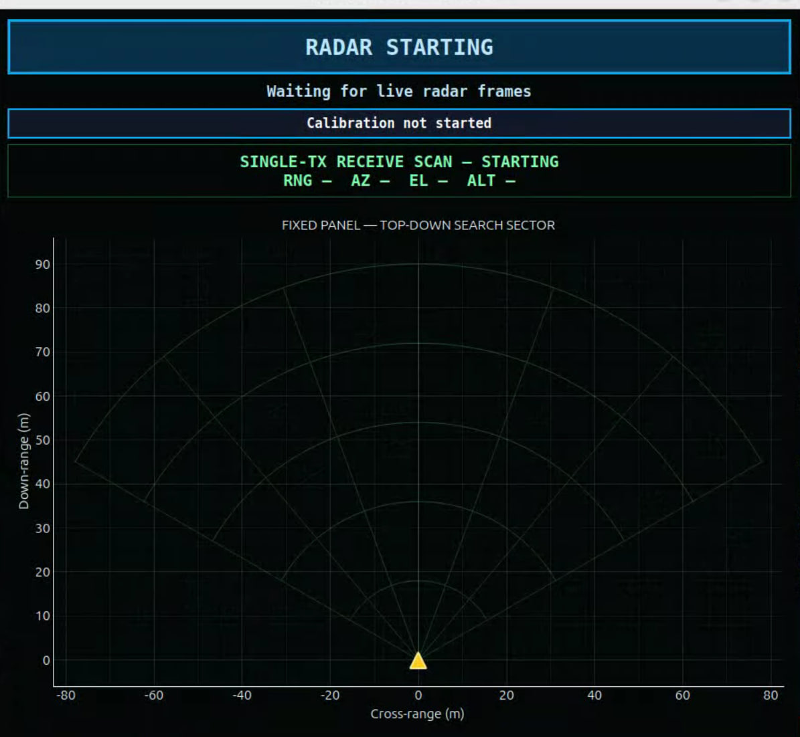 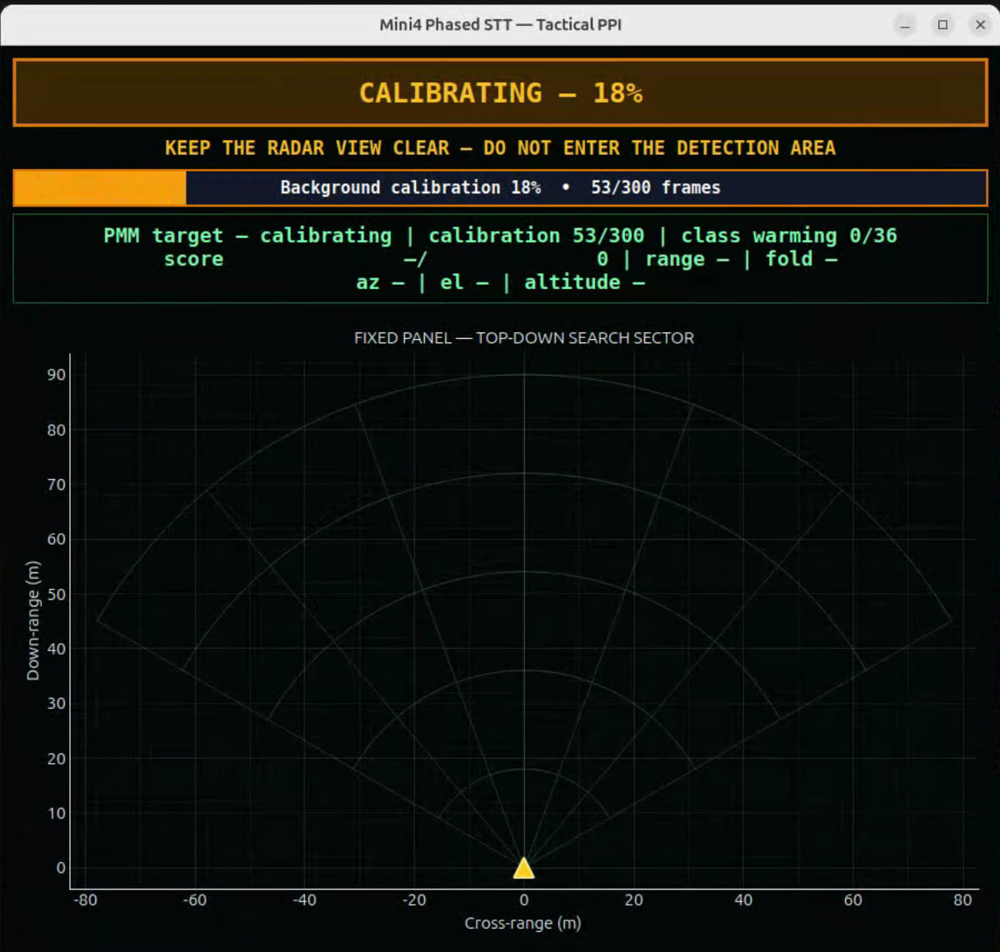

### 5.2 Searching and acquiring

Once calibration completes, the banner turns green and reads RADAR READY, SEARCHING (Figure 3). The status box under the banner shows what the tracker and classifier are doing (Table 13).

**Table 13.** Status readouts on the display.

| Readout | Meaning |
|---|---|
| searching / tentative / confirmed | Track state. A tentative track needs several consistent frames before it is confirmed |
| calibration 300/300 | Background frames collected |
| class warming n/36 | Frames of target history collected so far. The classifier needs 36 before it gives a label |
| score a / b | Current detection score against its threshold |
| range, az, el | Target distance, azimuth and elevation angles |
| altitude | Height relative to the radar, worked out from range and elevation |
| fold | Folding size that gave the strongest rotor-periodicity score (PMM modes) |

When a target is confirmed, the banner changes to TARGET TRACKED and a red marker appears. While the classifier is still collecting history, the marker's label counts up, for example CLASSIFYING 35/36 in Figure 4.

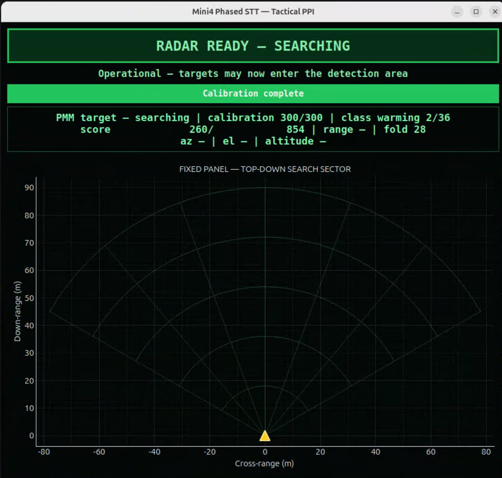 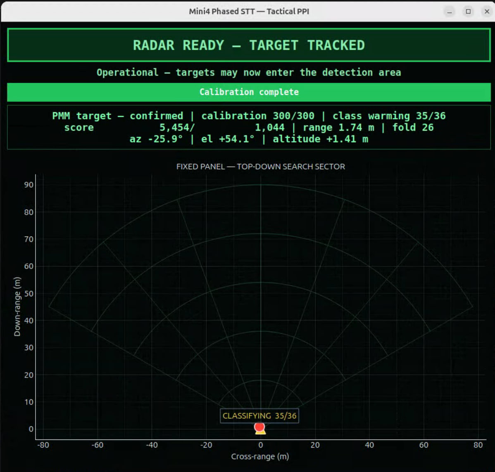

### 5.3 Tracking and classification

Figure 5 shows a confirmed track at 9.41 m, 27 degrees to the left of boresight, labelled UAV / DRONE. Figure 6 shows the green trail left by a target moving across the sector at about 11 m down-range. The track has dropped back to tentative and the classifier is warming up again after the interruption.

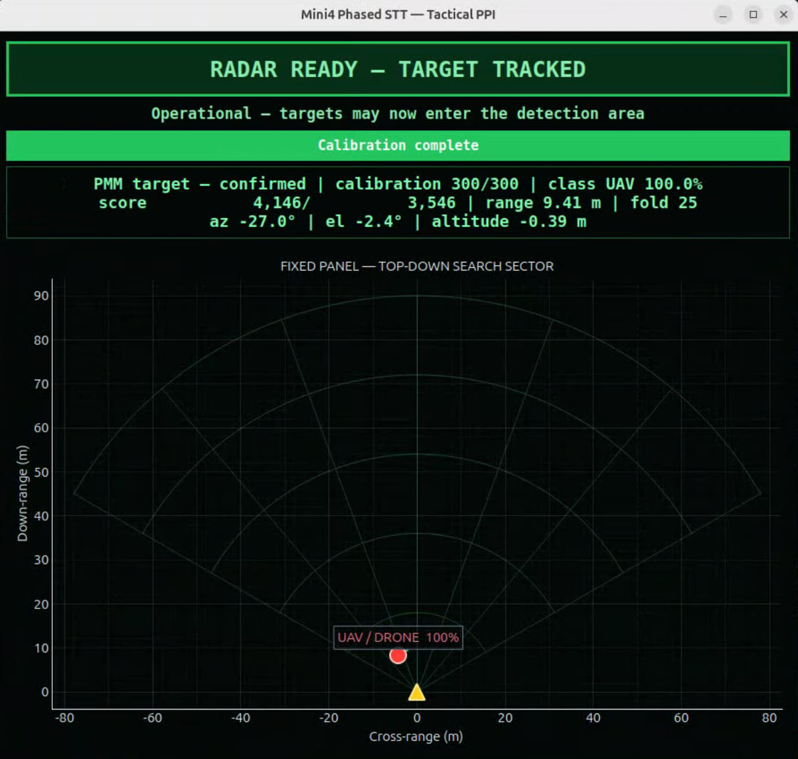 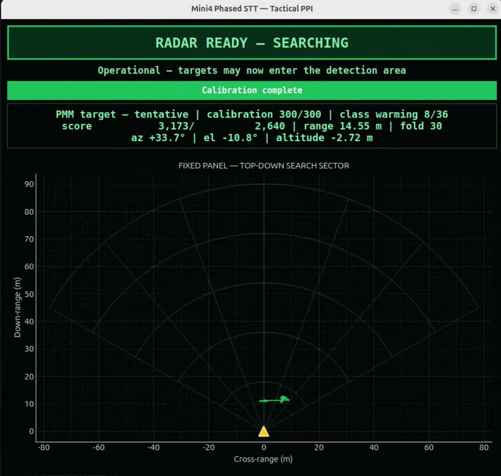

[INSERT: confirm which mode and which target each of Figures 1 to 6 shows. The window title reads "Mini4 Phased STT", the range rings go to 90 m and the status line reads "PMM target", so these appear to be from the long-range profile before the 13 November rebuild. Figure 1 shows the single-transmitter receive-scan mode.]

Figure 7 shows the same display driven by the conventional pipeline. The range rings stop at 20 m to suit the shorter profile. A target at 3.72 m has been followed along the green trail and labelled NOT_DRONE.

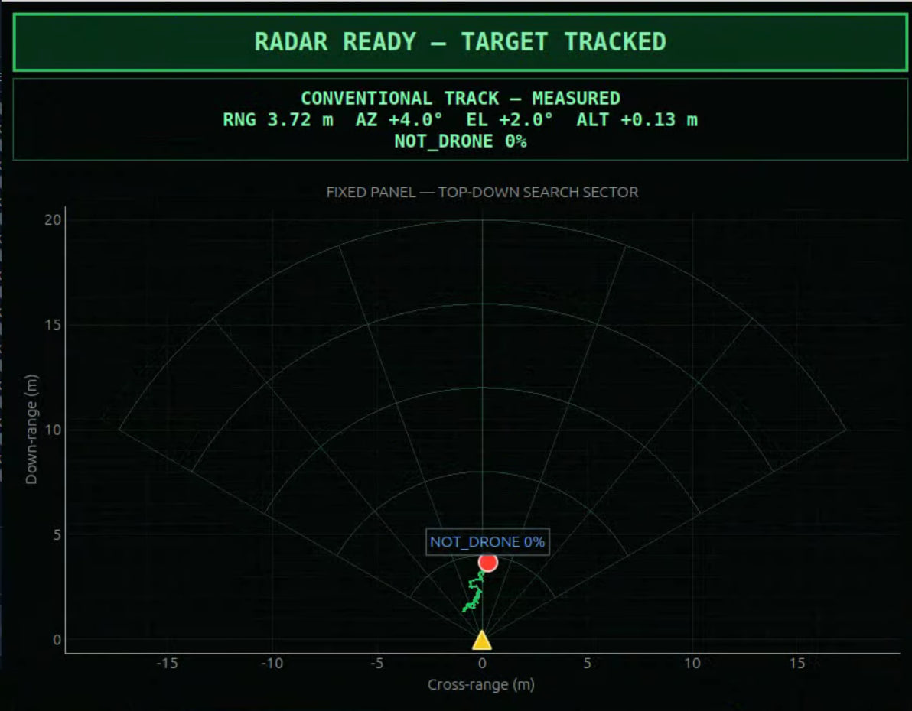{w=9.5}

### 5.4 Comparison with the first-stage display

Figure 8 and Figure 9 show the Stage 1 display for Mode 2. The left panel is a 3D view and the right panel is the Doppler-time history fed to the classifier. It shows the signal well, but the operator has to read the target position from the text line. In Figure 8 the classifier still reports UAV 100% while the tracker is only searching, which is the kind of mismatch the new banner and marker labels are meant to make obvious.

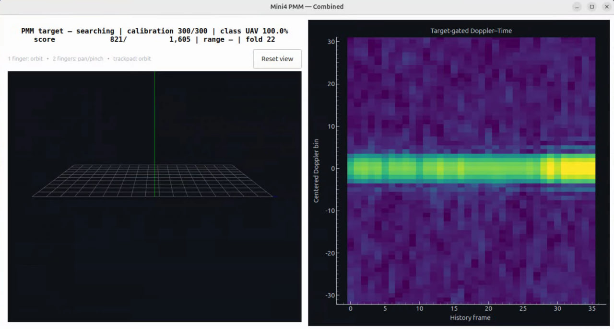 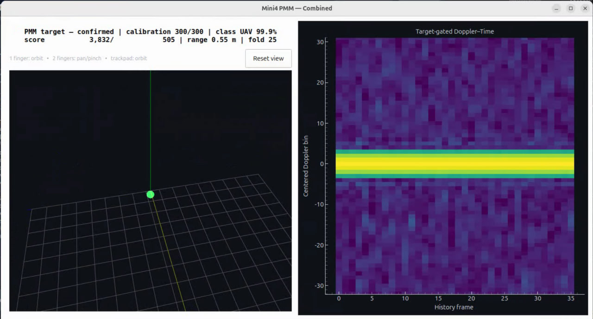

## 6. Stage 2 test method

### 6.1 Target and setup

Field tests used a DJI Lito X4, an updated version of the Mini 4 with almost identical physical dimensions, and a walking person. The radar was on its tripod with the chassis and power bank as in Stage 1.

**Table 14.** Stage 2 test setup. [INSERT: complete the blank cells.]

| Item | Value |
|---|---|
| Dates and site | [INSERT] |
| Radar height and pointing | [INSERT] |
| Drone | DJI Lito X4 |
| Drone motion | [INSERT: hovering, flying outward, crossing] |
| Person | [INSERT: who, walking pace] |
| Distance reference | [INSERT: tape, laser range finder, or radar's own reading] |
| Rule for "detected" | [INSERT: for example, a confirmed track held for a set time] |
| Number of passes per mode | [INSERT] |
| Surroundings | [INSERT: open field, car park, hall, nearby reflectors] |

### 6.2 Procedure

Each run began with the scene empty for the background calibration. The target then moved outward from the radar until the track was lost, and back again. The interface saved a processed-data log, a runtime log and a classification log for every run.

[INSERT: describe in your own words how you ran the trials, including anything you did to keep the drone's speed and path consistent.]

## 7. Results

### 7.1 Detection range

Table 15 brings the range results together.

**Table 15.** Detection and tracking range by mode.

| Mode | Stage | Drone | Person | Source |
|---|---|---|---|---|
| Mode 1, hovering drone | 1 | 3.16 m (3.66 m with tape) | Further than the drone; not measured | [1] |
| Mode 2, hovering drone | 1 | 3.64 m (3.96 m with tape) | Further than the drone; not measured | [1] |
| Mode 1, moving drone | 1 | about 6.5 m (about 7 m with tape) | [INSERT] | My runs [INSERT: confirm] |
| Mode 3 | 2 | about 9 m | about 11 m | My field tests |
| Mode 4 | 2 | 11 to 12 m | 11 to 12 m | My field tests |

Both new modes reached further than Stage 1. Mode 4 performed best and is the only mode that held the drone as far as a person. It detected the drone about 4 to 5 m further than the best first-stage figure, and it did so with the same radar profile as Mode 1, so the gain came from processing alone. Mode 4's result is also close to the 12.5 m limit of its profile, which means it cannot be pushed much further without changing the radar settings.

Mode 3 reached about the same distance as Mode 4 for a person but fell about 2 to 3 m short for the drone.

### 7.2 Mode 3 walking-person track

The archived Mode 3 run of 13 November [7] contains one clear out-and-back pass (Table 16). The run was not labelled, so the target's identity comes from the test notes and not from the log. [INSERT: confirm who walked.]

**Table 16.** Mode 3 track of a walking target, 13 November 2026, from the processed-data log.

| Time (SGT) | Event | Range |
|---|---|---|
| 02:19:16 | Track confirmed | 1.7 m |
| 02:19:16 to 02:19:36 | Held continuously while moving outward at 0.6 to 0.8 m/s | 1.7 m to 12.6 m |
| 02:19:36 | Track lost | 12.6 m |
| 02:19:47 | Track picked up again on the return | about 11.0 to 11.6 m |
| 02:19:48 to 02:20:01 | Held inbound, with one gap of about 1.5 s near 7.5 m | 11.0 m to 1.7 m |

The classifier labelled this target "other" (not a drone) with 0.99 to 1.00 confidence throughout. These distances are the radar's own readings in steps of about 37 cm, with no independent reference.

### 7.3 Running on the Jetson

Table 17 adds the new modes to the Stage 1 runtime figures.

**Table 17.** Runtime on the Jetson by mode.

| Mode | Frame period | Frame rate | Processing time, median / 95th percentile | Frames over the period | Packets lost | Source |
|---|---|---|---|---|---|---|
| Mode 1 | 33.3 ms | 29.6 to 29.7 fps | 20.0 / 31.8 ms | 2.97% | 0 | [2] |
| Mode 2 | 100 ms | 9.8 to 9.9 fps | 76.5 / 84.0 ms | 1.38% | 0 | [2] |
| Mode 3 | 100 ms | 9.88 fps | 80.8 / 89.9 ms | 1.77% | 0 of 885,816 | Run of 13 November [7] |
| Mode 4 | 33.3 ms | [INSERT] | [INSERT] | [INSERT] | [INSERT] | [INSERT: runtime log] |

Mode 3 processed 3,279 frames in 332 s and stayed inside its 100 ms frame period on more than 98% of frames. Mode 1 already uses about 32 ms of its 33.3 ms period at the 95th percentile, so Mode 4 has little spare time. On a laptop its extra steps added about 2.5 ms per frame. [INSERT: Mode 4's measured timing on the Jetson, or a sentence on how it behaved.]

### 7.4 False targets in Mode 3

The same 13 November run exposed a false-target problem. With no one in the scene, the rebuilt Mode 3 reported a target near 6.1 m at 46 degrees to the left and held it for 2,293 consecutive frames, which was most of the run. In other runs I also saw it settle at about 2 m, and it could hold a false position after the real target had left.

This was not caused by lost data, since the run had no lost packets or dropped frames. The log showed that the Doppler bins next to zero velocity were 26.5 dB stronger than all the others at that range. Strong reflections from stationary objects were leaking into the bins used to find slow-moving targets.

I made four changes to correct this (Table 18).

**Table 18.** Mode 3 false-lock correction.

| Change | Before | After |
|---|---|---|
| Doppler bins around zero velocity | Used | Centre ±3 bins rejected |
| Background floor | None | 10% of each cell's background level |
| Frames of evidence required | 6 of 8 | All 8 |
| Evidence thresholds (integrated / current frame) | 4.5 / 2.0 | 5.5 / 3.0 |

[INSERT: state whether the correction was re-tested in the field and what happened.]

### 7.5 Classification at the new ranges

Classification did not extend to the new ranges and was unreliable beyond about 7 m. There are two reasons.

- **Training distance.** Both classifiers were trained only on first-stage recordings, all made within a few metres of the radar. They have no examples of how a target looks further away, where the signal is weaker and noisier.
- **Profile mismatch in Mode 3.** Mode 3 feeds the Mode 2 LSTM with data from a different radar profile and a different processing chain. The software detects this at start-up, reports that the classifier's expected input does not match, and marks every Mode 3 classification as experimental.

Mode 4 does not have the second problem because it uses Mode 1's profile and CNN unchanged.

[INSERT: any classification figures you recorded at range, for example the share of frames labelled correctly at set distances.]

## 8. Discussion

### 8.1 Why Mode 4 did better than Mode 3

Mode 3 changed the profile to make long ranges representable, but representable is not the same as detectable. At the 9 to 12 m actually reached, the Mode 1 profile already covers the distance, and its 20 cm range bin puts less background into the same cell as the drone than Mode 3's 37 cm bin does. Mode 3's 10 Hz frame rate also gives its multi-frame step fewer looks per second than Mode 4's 30 Hz.

Mode 4's largest simulated gain came from the simplest change, which was correcting a threshold that had been set far stricter than intended. This suggests that the first-stage range was limited partly by how the detector was tuned and not only by the hardware.

A person reflects much more strongly than a small drone, which is why Mode 3 could hold a person to 11 m while losing the drone at 9 m. Mode 4 held both to 11 to 12 m, which suggests it was stopped by the 12.5 m profile limit and not by signal strength. [INSERT: your own view on whether this matches what you saw in the field.]

### 8.2 Relation to the first-stage recommendations

Qi Xuan recommended investigating coherent or non-coherent integration across repeated observations [1]. Mode 3 and Mode 4 both do this, and the range gain supports that recommendation. Xian Yang proposed a hybrid in which the conventional method finds moving targets and the PMM method adds evidence for hovering drones [2]. Stage 2 did not build that hybrid. Mode 4 strengthens the conventional side only, so its behaviour against a hovering drone at long range still needs to be tested.

### 8.3 The operator interface

The interface removed the need to remember command options and made failed starts recoverable with one button. The top-down display made it possible to follow a target and its path during a test without reading numbers. I did not measure setup time or operator error, so these are observations from my own use. [INSERT: your own reflection on using the interface during field tests.]

## 9. Limitations

- **Two devices are needed.** The Jetson has no display attached, so a laptop running RustDesk is needed to operate it, and both must be on the same Wi-Fi network. This adds delay and bulk and reduces portability.
- **The stages are not directly comparable.** Stage 1 and Stage 2 used different drones, radar settings and test procedures. The results show the direction of progress and are not a like-for-like comparison.
- **No independent position reference.** Stage 2 distances were [INSERT: how measured]. Without a surveyed or instrumented reference, range accuracy at the detection boundary cannot be stated.
- **One drone type and few trials.** Only the DJI Lito X4 was tested in Stage 2. Other drones may behave differently.
- **Cluttered test sites.** The false-target problem shows how much stationary reflectors affect the result. A clean, instrumented range would have improved the quality of the data.
- **Classification lags detection.** The radar can now track targets it cannot yet classify reliably.
- **Mode 4 is at its profile limit.** It cannot see beyond about 12.5 m without a different profile.

## 10. Recommendations

1. Fit a portable touchscreen monitor with a DisplayPort input so that the system can be used on its own, without a second computer and remote-desktop software.
2. Collect labelled drone and non-drone recordings with Mode 3 and Mode 4 at the new distances, with a wider range of drone sizes, and retrain the classifiers. Keep whole recording sessions and locations in separate training and test groups, as both groupmates recommended [1], [2].
3. Repeat matched trials at measured distances for Mode 1 and Mode 4 with the same drone, switching Mode 4's four steps on one at a time to find which ones give the gain in the field.
4. Record an independent reference position, for example the UWB tag and anchors that Xian Yang proposed [2], so that range, tracking and timing can be compared on the same basis.
5. Give Mode 4 a profile with a longer unambiguous range and a similar range bin, so that it is no longer capped at 12.5 m.
6. Re-test the Mode 3 false-lock correction in empty and occupied scenes and report false tracks per minute alongside range.

## 11. Conclusion

This project showed that a portable radar built from off-the-shelf parts can detect and track small drones in real time on an edge computer. Stage 1 produced the working prototype, two processing methods and trained classifiers, with a hovering drone detectable to about 3 to 4 m. In Stage 2, I added an operator interface with a top-down target display and two extended-range modes. Mode 4 detected a small drone and a person out to 11 to 12 m using the same radar settings as Mode 1, so the gain came from better processing. Mode 3 reached about 11 m for a person and 9 m for the drone, and exposed a false-target problem that was traced to stationary clutter and corrected in software. Classification has not yet followed detection to the new distances.

[INSERT: your closing remarks in your own words. Your executive summary makes two points you may want to repeat here: that hardware with more power or more antenna elements in a similar form factor could reach much further with the right processing, and that an instrumented range with a clean background and a more rigorous test plan would have improved the results.]

## References

[1] You Qixuan, *Radar-UREx: Portable COTS mmWave Radar for UAV Detection, Tracking and Classification*, UREx project report, National University of Singapore, Sep. 2026.

[2] Weng Xian Yang, *Portable COTS mmWave Radar for UAV Detection, Tracking and Classification: Comparative design study of conventional range-Doppler / micro-Doppler processing and a paper-inspired periodic-micro-motion pipeline*, UREx project report, National University of Singapore, Sep. 2026.

[3] Y. He, J. Zhang, R. Xi, X. Na, Y. Sun, and B. Li, "Detection and identification of non-cooperative UAV using a COTS mmWave radar," *ACM Trans. Sensor Netw.*, vol. 20, no. 2, Art. no. 44, 2024, doi: 10.1145/3638767.

[4] Texas Instruments, *DCA1000EVM Data Capture Card User's Guide*. Dallas, TX, USA: Texas Instruments, 2020.

[5] Texas Instruments, "IWR6843ISK-ODS evaluation board," TI.com. [Online]. Available: https://www.ti.com/tool/IWR6843ISK-ODS.

[6] Infocomm Media Development Authority, "Technical Specification for Short Range Devices," IMDA TS SRD, Sep. 2023.

[7] Radar-UREx project repository, branch aesa-recovery-2026-11-11, including conventional_radar/README_MODE4.md, aesa_radar/TEST_DAY_GUIDE.md and evidence/2026-11-13_mode3_false_lock/. [INSERT: repository link and access date.]

[INSERT: a declaration of generative AI use, if your department requires one.]

[[PAGEBREAK]]

## Appendix A. Chassis design

I designed the chassis in SolidWorks and 3D-printed it. It is a single L-shaped part that holds the radar assembly upright and carries the power bank on its base (Figures A1 to A3).

**Table A1.** Chassis features visible in the model.

| Feature | Purpose |
|---|---|
| Vertical plate with four mounting holes | Carries the radar and capture-board assembly facing forward |
| Base plate | Sits on the tripod and supports the power bank |
| Rounded open-topped pocket and upright posts on the base | Hold the power bank so that it can be lifted out and swapped |
| Diagonal rib between the vertical plate and the base | Stiffens the vertical plate so the radar's pointing direction does not shift |
| Stepped recess on the underside | [INSERT: confirm purpose, for example seating the tripod's quick-release plate] |

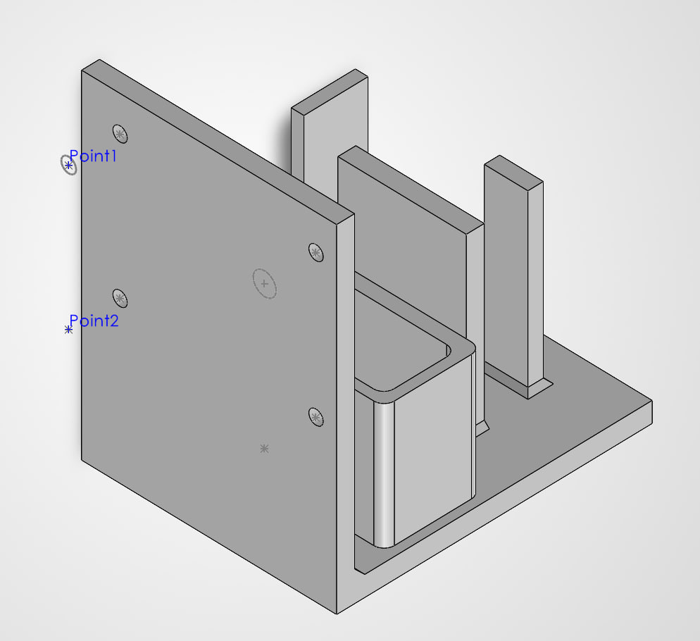 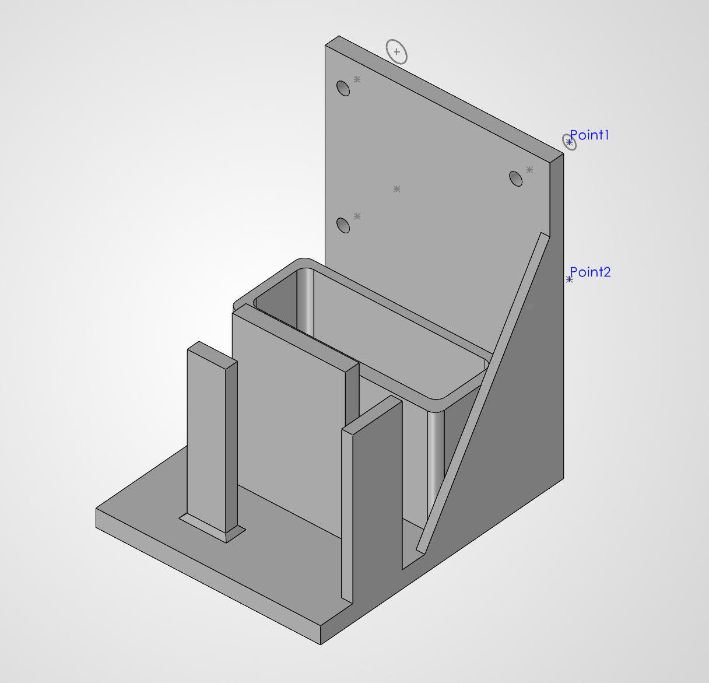

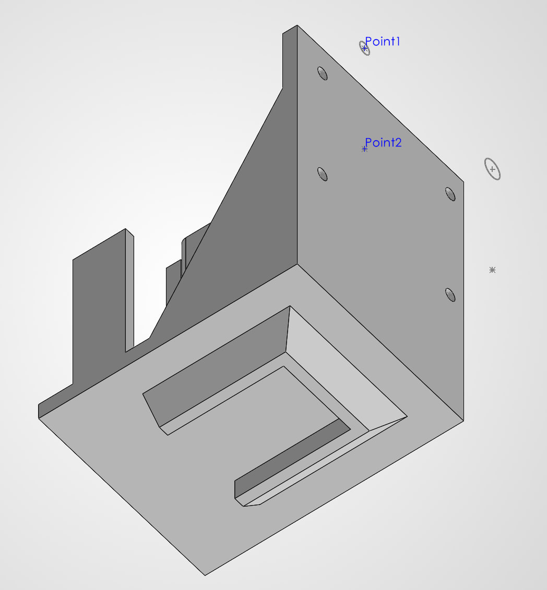{w=7.5}

**Table A2.** Chassis details. [INSERT: complete.]

| Item | Value |
|---|---|
| Overall dimensions | [INSERT] |
| Material and printer | [INSERT] |
| Print settings (layer height, infill) | [INSERT] |
| Mass | [INSERT] |
| Fasteners | [INSERT] |
| Power bank model | [INSERT] |

[INSERT: your design reasoning in your own words. For example: why an L-shape, how you chose the radar height and hole spacing, how many versions you printed and what you changed between them, and what you would change next.]
